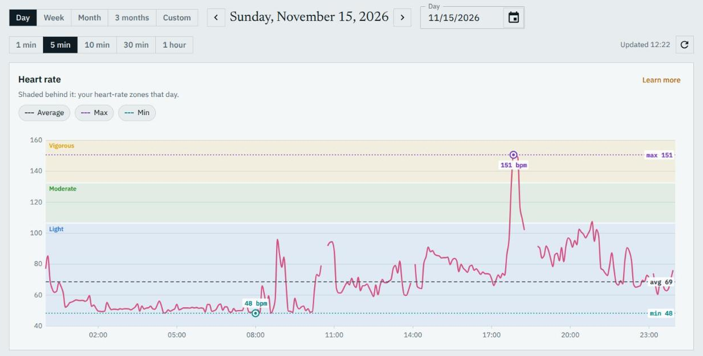
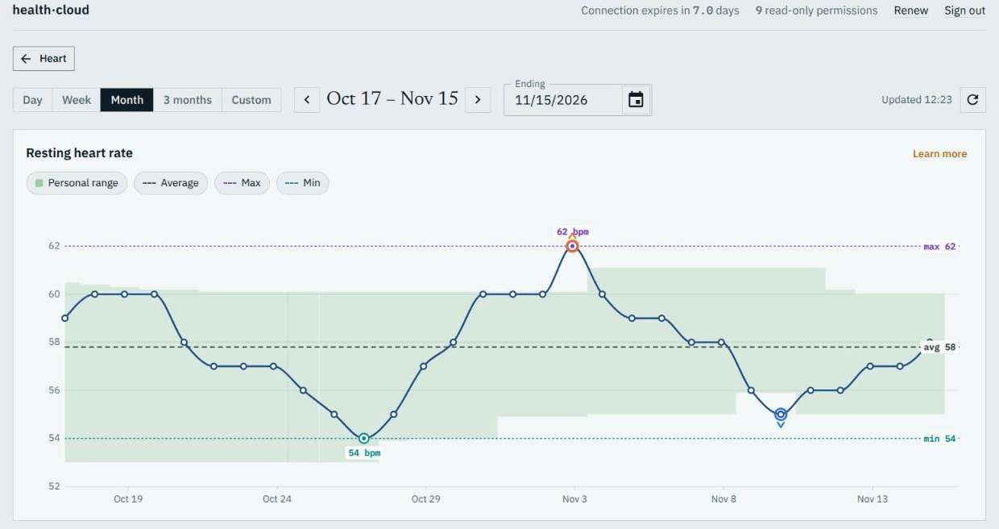
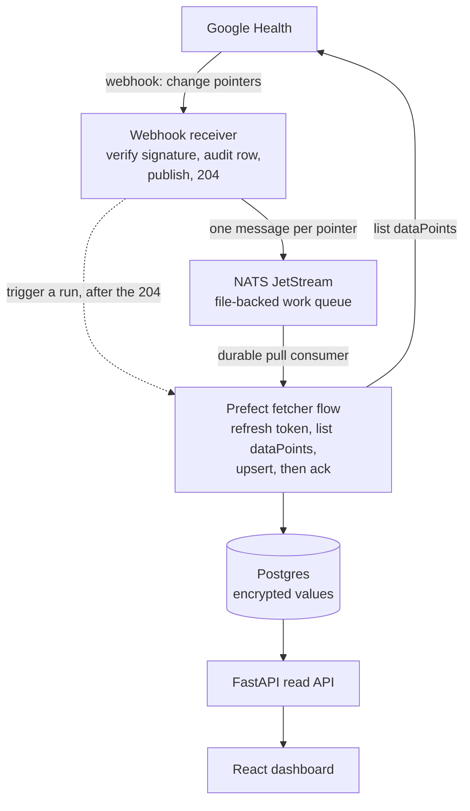

# health-cloud

A self-hosted pipeline for personal Google Health data. It receives change
notifications from Google, fetches the measurements from the Google Health API,
stores them encrypted in Postgres, and presents them in a React dashboard.

It supports any device that syncs to Google Health: Fitbit trackers, Pixel
Watch, and other Google Health app devices. It is built for a single user, runs
locally during development, and is designed for deployment on a self-hosted
server.

## Screenshots

The home page shows the day's key figures against the 7-day average and the
usual range:


A single day of heart rate at five-minute resolution, over the heart-rate zones:



Resting heart rate over a month, against the personal range:



## Features

- **Push-based ingestion.** Google's webhook notifications are verified,
  recorded and queued durably before they are acknowledged, so a crash never
  loses an update.
- **Idempotent fetching.** A Prefect flow pulls the notified intervals from the
  Health API and upserts them, so replays and retries never duplicate data.
- **Backfill CLI.** Fills history or gaps directly from the API, a day at a
  time.
- **Encryption at rest.** Every stored health value, and the OAuth tokens, are
  encrypted with AES-256-GCM in the application. The database never holds
  plaintext measurements.
- **Read-only access.** The app requests read-only Health API scopes and never
  writes back to Google.
- **Dashboard.** Heart rate, HRV, sleep, breathing and blood oxygen, activity,
  exercise, running, nutrition and body measurements, over a single day, a week,
  a month, three months or a custom range.

## Architecture



Google's webhook delivers **change pointers, not health data**: it says that a
data type changed for a user over an interval, and the values must then be
fetched from the Health API. The design follows from that:

1. **The receiver** verifies the request signature, writes an audit row,
   publishes one message per change pointer to NATS JetStream, and only then
   answers `204`. Any failure answers `503`, so Google redelivers. It does
   nothing slow or fragile.
2. **The fetcher**, a Prefect flow, drains the queue. It refreshes the OAuth
   token, lists the notified interval from the Health API, handles pagination
   and rate limits, upserts the rows, and acknowledges each message only after
   its rows are committed.
3. **Storage** is organised by the shape of the data in time (instantaneous
   samples, intervals, sessions with segments, and daily values) rather than by
   data type. Types the schema does not model yet land intact in a catch-all
   table.
4. **The read API** decrypts and aggregates in Python, since encrypted values
   cannot be summed in SQL, and serves only the columns each chart needs.
5. **The dashboard** fetches through a small in-memory cache that refreshes in
   the background. It never writes health data to browser storage.

## Tech stack

| Area | Choice |
| --- | --- |
| Backend | Python 3.13, FastAPI, SQLModel, `psycopg` (synchronous) |
| Database | Postgres 17 |
| Queue | NATS JetStream, file storage |
| Orchestration | Prefect 3, self-hosted |
| Auth | Google OAuth (`google-auth-oauthlib`), HS256 JWT session cookie |
| Cryptography | `cryptography` AES-256-GCM; Tink for Google's webhook signatures |
| Frontend | React 19, Vite, MUI, nivo charts, plain JavaScript |
| Tooling | uv, pytest, mypy, oxlint, Docker Compose |

## Repository layout

```
server/              FastAPI backend, imported as server.<module>
  api/               HTTP routes: auth, webhooks, health checks, /data reads
  auth/              OAuth flow, sessions, users
  crypto/            token, session and health-value encryption
  db/                engine, sessions, upserts, read repository
  models/            SQLModel tables
  webhooks/          signature verification and payload parsing
  queue/             NATS JetStream publishing and consuming
  health/            Google Health API client
  flows/             Prefect fetcher and heart-rate rollup flows
  rollup/            hourly heart-rate summaries: rebuilding and reading
  aggregation/       bucketing and summaries for the read API
  cli.py             subscriber, database, backfill and rollup commands
client/              React dashboard (Vite)
tests/               pytest suite, mirroring server/
docs/                design documents
deploy/              container health checks
Dockerfile           the API and worker images
docker-compose.yml   the app's three containers, plus Postgres, NATS, Prefect
                     and Prefect's database
```

## Getting started

### Prerequisites

- [uv](https://docs.astral.sh/uv/)
- Docker with Docker Compose
- Node.js and npm
- A Google Cloud project with the Google Health API enabled, an OAuth client
  for a web application, and a service account for managing the webhook
  subscriber. See [Google Health API setup](https://developers.google.com/health/setup).
- For live notifications during development, a public HTTPS URL that forwards
  to the local server, such as an [ngrok](https://ngrok.com/) static domain.

### 1. Configure

```bash
cp .env.example .env
```

Fill in `.env`. Every setting is required, and each one is described in
`.env.example`. Generate the three secrets with:

```bash
openssl rand -hex 32   # once each for TOKEN_ENCRYPTION_KEY, SESSION_SECRET, DATA_ENCRYPTION_KEY
```

Keep `DATA_ENCRYPTION_KEY` safe: without it the stored measurements cannot be
read.

### 2. Start everything

```bash
docker compose up -d --build --wait
```

This builds and starts the API, the Prefect worker and the dashboard alongside
Postgres, NATS and Prefect. Open <http://localhost:7780> and choose **Connect
Google Health**. Google shows an "unverified app" warning, since the OAuth
client is private and has not been through Google's app verification.

The defaults in `.env.example` are for this setup. The OAuth client in GCP must
list `http://localhost:7781/auth/google/callback` as a redirect URI. See
[Running with Docker](#running-with-docker) for what each container does.

### 3. Running on the host instead

For development with reloading, run only the infrastructure in containers and
the app directly. Switch the values marked `host:` in `.env` first: the API is
then on port 8000 and the dashboard on 5173.

```bash
docker compose up -d postgres nats prefect prefect-services
uv sync
uv run uvicorn server.main:app --workers 3
```

Run the API with several workers. Reads decrypt in Python on one core per
worker, so a single worker busy with a long heart-rate read would hold up every
other request.

Health checks:

- `GET /healthz`: liveness
- `GET /readyz`: readiness, which checks both Postgres and NATS

`prefect` is in its own dependency group, so the web process never installs it.
In a separate terminal, run and leave running:

```bash
uv run --group prefect python -m server.flows.fetch deploy
```

This registers the `fetcher` and `rollup-heart-rate/rollup` deployments and
serves their runs. The API and the backfill find both deployments by name, so
nothing it prints needs copying into `.env`.

To drain the queue once without serving a deployment:

```bash
uv run --group prefect python -m server.flows.fetch
```

Then the dashboard:

```bash
cd client
npm install
npm run dev
```

and open <http://localhost:5173>.

### 4. Register the webhook subscriber

With the API reachable at `WEBHOOK_PUBLIC_URL`:

```bash
uv run python -m server.cli subscriber create
uv run python -m server.cli subscriber sync-types   # subscribe to every data type
uv run python -m server.cli subscriber list
```

`subscriber patch` repoints the registration at a new URL, for example when
moving from a development tunnel to production.

### 5. Backfill history

Google only notifies about new changes, so fill past data directly:

```bash
uv run python -m server.cli backfill run --types steps sleep heart-rate --days 7
```

Data type ids are kebab-case (`heart-rate`, not `heart_rate`). Heart rate is
about 34,000 points a day, and the Health API keeps only about a week of it.
A backfill that includes heart rate ends by starting a rollup run, which
rebuilds the hourly summaries the long heart-rate charts read; it needs the
Prefect deployments served.

## Running with Docker

The same stack runs entirely in containers, which is how it runs in
production. `docker-compose.yml` defines three app services alongside the
infrastructure:

| Service | Image | Runs | Published on |
| --- | --- | --- | --- |
| `api` | `health-cloud-api` | `uvicorn server.main:app --workers 3` | `127.0.0.1:${API_PORT:-7781}` |
| `worker` | `health-cloud-worker` | `python -m server.flows.fetch deploy` | not published |
| `client` | `health-cloud-client` | Caddy serving the production build | `127.0.0.1:${CLIENT_PORT:-7780}` |

Build and start everything from the working tree:

```bash
docker compose up -d --build --wait
```

The app containers read `.env`, with the addresses of Postgres, NATS and
Prefect replaced by their service names, and `service-account.json` mounted
read-only. One-off commands run in the API image:

```bash
docker compose run --rm api python -m server.cli backfill run --days 7
```

The client image holds no API address. `API_BASE_URL` is served to the browser
as `/config.js` when the container starts, so one image serves any
deployment. `npm run dev` keeps reading `VITE_API_BASE_URL` instead.

### Health checks and restarts

Every container restarts with `restart: unless-stopped`. Docker restarts a
process that exits, but only marks a hung one unhealthy, so each app container
runs its probe through `deploy/healthcheck.sh`, which stops the container after
three consecutive failures (TERM, then KILL on the next failure) for the restart
policy to bring it back. Failures in the first 60 seconds after a start are not
counted.

| Service | Healthy when |
| --- | --- |
| `api` | `GET /healthz` answers (liveness, not readiness: restarting it does not fix a database outage) |
| `worker` | Prefect does not report the `fetcher` deployment as `NOT_READY`, which it does once the serving process stops polling |
| `client` | Caddy answers `GET /` |

### Images and releases

CI publishes the images to GHCR once the tests pass:

- a push to `main` publishes `sha-<short>`;
- a `vX.Y.Z` tag publishes `X.Y.Z`, `X.Y` and `latest`.

Releases are tagged by hand:

```bash
git tag v0.1.0 && git push origin v0.1.0
```

`APP_VERSION` selects the tag Compose runs; it defaults to `dev`, the tag a
local build produces. A deployment that follows releases sets
`APP_VERSION=latest` and runs `docker compose pull && docker compose up -d`.
A release that changes `docker-compose.yml` or adds a setting must have that
file copied to the server by hand, since the server holds no checkout.

### Production settings

Any `ENVIRONMENT` other than `local` is production: logs are written as JSON
without local variables, and direct reads of the NATS stream are disabled. A
production `.env` also sets `COOKIE_SECURE=true`, and points `FRONTEND_URL`,
`CORS_ORIGINS`, `GOOGLE_REDIRECT_URI` and `API_BASE_URL` at the public
hostnames. The redirect URI must also be registered on the GCP OAuth client.

## Development

```bash
uv run mypy          # type check, run first in CI
uv run pytest        # test suite
cd client && npm run lint && npm run build
```

Tests under `tests/integration/` use real Postgres and NATS, with a throwaway
database and their own stream. They are skipped when the services are not
running, and always run in CI.

Other commands:

```bash
uv run python -m server.cli db reset-measurements   # drop and recreate the measurement tables; users are kept
uv run python -m server.cli rollup rebuild --days 120   # rebuild the hourly heart-rate summaries from stored samples
```

## Security

- Health values, OAuth tokens and the raw notification log are encrypted at
  rest with AES-256-GCM, using separate keys for tokens and health data.
- Webhook requests are authenticated with a shared secret and verified against
  Google's published signing keys.
- Sessions are HS256-signed, HTTP-only cookies. Credentialed requests are
  accepted only from the origins in `CORS_ORIGINS`.
- NATS and Prefect have no authentication of their own and are bound to
  localhost, as are the API and client ports.
- The published images are public and contain no secrets: `.dockerignore`
  keeps `.env` and the Google credential files out of every build.
- Logs never contain health values or personal details.

## Documentation

The design is documented in [`docs/`](docs/). Start with
[`docs/CONTEXT.md`](docs/CONTEXT.md), which covers the architecture and the build
order, and links to a document for each area:

| Document | Covers |
| --- | --- |
| [Stack](docs/stack.md) | Library choices and code conventions |
| [Ingestion](docs/ingestion.md) | Webhook payloads and signature verification |
| [Orchestration](docs/orchestration.md) | NATS, Prefect and delivery guarantees |
| [Data model](docs/data-model.md) | Tables and upserts |
| [Authentication](docs/auth.md) | OAuth, sessions and token storage |
| [Encryption](docs/encryption.md) | Encryption at rest |
| [Observability](docs/observability.md) | Logging and error handling |
| [Testing](docs/testing.md) | Test strategy and fixtures |
| [Operations](docs/operations.md) | Subscriber management and deployment |
| [Charting](docs/charting.md) | The dashboard |
| [Decisions](docs/decisions.md) | Open, deferred and rejected decisions |

## Status

The ingestion pipeline, encryption, read API, dashboard and stored hourly
heart-rate summaries are complete, and the whole stack runs in containers. Still
to come: production deployment behind Cloudflare Tunnel, then a scheduled daily
reconciliation with alerts on token expiry.
