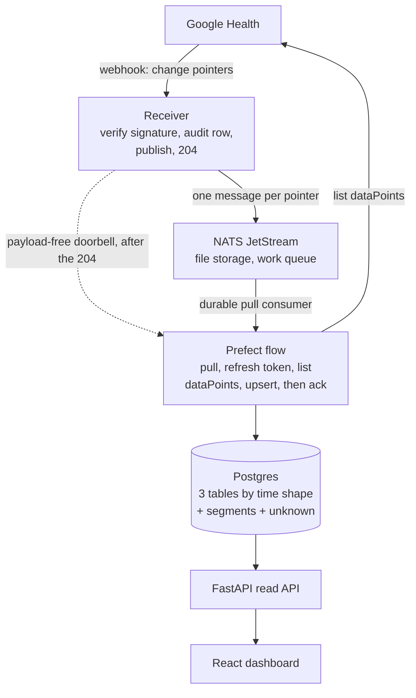

# health-cloud — design context

Agreed 2026-09-22. This records *what was decided and why*, so the reasoning
survives past the conversation that produced it.

## What it is

A self-hosted personal pipeline that ingests Google Health data from compatible
devices (Fitbit trackers, Pixel Watch, other Google Health app devices), stores
it in Postgres, and displays it in a React dashboard.

Single user. Runs locally during development, then on an existing self-hosted
server.

## The pipeline

**The webhook does not deliver health data** — it delivers change pointers, and
the values must then be fetched from the Health API. That is the constraint the
whole design follows from; see [Ingestion](ingestion.md) for the payload shape
and the endpoint's obligations.

The receiver is deliberately dumb and fast: verify, record, publish,
acknowledge, nothing else. All fragile work (token refresh, pagination, rate limits) lives in
workers, where retries are free.

## Stack

| Concern | Choice |
| --- | --- |
| Language | Python 3.13 (backend), JavaScript (frontend — not TypeScript) |
| Web framework | FastAPI |
| ORM / models | SQLModel only — one direct SQLAlchemy import, for `JSONB` |
| Migrations | **None.** `SQLModel.metadata.create_all()` only |
| Database | Postgres, plain (no TimescaleDB) |
| DB driver | `psycopg` (sync) |
| Concurrency | Synchronous — SQLModel has no async engine |
| Outbound HTTP | `requests` |
| OAuth flow | `google-auth-oauthlib` |
| Crypto | `cryptography` AES-256-GCM for tokens at rest and, with a separate key, for health values at rest (step 6); PyJWT HS256 for session cookies; Tink **only** for Google's webhook signature keyset (step 3) |
| Message queue | NATS JetStream, file storage, drained by a Prefect pull consumer |
| Orchestration | Prefect 3, self-hosted; triggered over its REST API, never imported by the web process |
| Flow code | `server/flows/`, `prefect` in its own dependency group |
| Frontend | React |
| Layout | Monorepo: `server/` + `client/`, separate deploy artifacts |
| Config | `.env` |
| Tests | pytest |

Why each row was chosen, and the conventions that follow from it, are in
[Stack rationale and conventions](stack.md).

## Design docs

The detail lives in the documents below, one per area. **Open the one covering
the area you are about to touch** — each holds the decisions already made there,
and the reasoning is what stops a settled question being reopened by accident.

| Document | Read it when |
| --- | --- |
| [Stack rationale and conventions](stack.md) | Choosing a library, or writing code that has to match the house style |
| [Ingestion](ingestion.md) | Touching the webhook receiver, the payload parser, or signature verification |
| [Orchestration](orchestration.md) | Touching NATS, the Prefect flows, or anything that must not lose a notification |
| [Data model](data-model.md) | Adding a table or column, or writing anything that upserts |
| [Authentication and token lifetime](auth.md) | Touching OAuth, sessions, cookies, or token storage |
| [Encryption at rest](encryption.md) | Adding a column, reading measurements, or anything that touches stored health values |
| [Observability](observability.md) | Adding logging, or handling an error on a path that sees health data |
| [Testing](testing.md) | Writing tests, or building a fixture |
| [Operations](operations.md) | Registering a subscriber, changing the public URL, or deploying |
| [Decisions: open, deferred, rejected](decisions.md) | Before proposing anything — it records what is undecided and what was already turned down |

## Build order

Progress marker — tick a box only when the step is genuinely complete.
**Each step requires explicit confirmation before implementation.**

- [x] **1. Project skeleton** — monorepo `server/` + `client/`, docker-compose
      Postgres, `.env` scaffold, add `.env` to `.gitignore`
- [x] **2. Google OAuth end to end** — consent flow, encrypted token storage,
      JWT cookie session, one-click re-consent
- [x] **3. Webhook receiver** — signature verification, 200/401 handshake,
      audit row, publish to NATS JetStream, 204 ack, **with pytest coverage**
      — *done 2026-09-25.* `raw_notifications` holds one row per delivery with
      the payload as `jsonb`; one message per change pointer goes to
      `health.notifications.<dataType>` on a file-backed work-queue stream, and
      the 204 waits on both. Verified end to end against a booted app: a batched
      delivery produced one audit row with `pointer_count: 2` and two messages in
      the stream. Readiness reports both dependencies. 143 tests, including
      integration tests against real Postgres and real NATS in CI.
- [x] **4. Subscriber CLI + ngrok static domain** — register a real subscriber,
      confirm live notifications land
      — *done 2026-09-24.* The subscriber named in `SUBSCRIBER_ID` was
      registered on the project in `GCP_PROJECT_NUMBER` against an ngrok static
      domain; Google's handshake was observed passing from its own IPs (401 then
      200), and real `sleep` / `distance` notifications acknowledged with 204.
      Identifiers live in `.env`, never here.
- [x] **5. Fetcher flow** — a Prefect flow that pulls from JetStream, refreshes
      the token, `list`s the notified interval, upserts idempotently and **then**
      acknowledges, **plus one-off backfill CLI**
      — *done 2026-09-28.* Measurements land in five tables keyed on Google's three
      time structures rather than on data type names. The receiver rings a
      payload-free doorbell at Prefect from a background task after the 204; the
      flow drains a durable pull consumer and acks only after each upsert commits.
      Verified against the live API, not just against fixtures: 36,000 heart-rate
      samples, 991 step and distance intervals, and a sleep session with 74 stages
      written, and a second identical backfill left the row count unchanged. The
      catch-all earned its place immediately: `daily-resting-heart-rate` turned out
      to carry a fourth time shape and landed there intact.
      Correcting the reference against real traffic was most of the work — kebab-case
      type ids, no `name` on a dataPoint, `sleep` filtering on `end_time`, a ~5000
      page cap, and seven types with no `list` at all. 299 tests.
- [ ] **6. Encryption at rest** — application-level AES-256-GCM on every
      health value (`value_numeric`, `value_unit`, `value`, `raw`,
      `raw_notifications.body`) through a `TypeDecorator`, structure left in
      plaintext; versioned format, zlib on the JSON columns; a minimal
      decrypting read repository; an integration test that reads raw rows and
      finds no plaintext; `db reset-measurements` CLI, then re-backfill from
      2026-09-20. See [Encryption at rest](encryption.md)
- [ ] **7. Read API routes** — FastAPI query routes over the read repository,
      selecting only the columns a chart needs; aggregation in Python, since
      encrypted values cannot be summed in SQL
- [ ] **8. React dashboard** — steps, sleep, heart rate
- [ ] **9. Prefect schedule** — daily 7-day `:reconcile` flow + push alerting
      on token expiry
- [ ] **10. Cutover to cloudflared** — subscriber PATCH to the self-hosted URL

Step 3 precedes step 4 deliberately: verification logic is tested against
fixtures before Google is ever pointed at the endpoint.

**That ordering was deviated from**, by choice, on 2026-09-24: step 4 was done
against a log-only receiver so that real deliveries could be seen before
persistence was built. It was the right call for an unrelated reason — real
traffic immediately exposed the payload-shape error that fixtures had not.
Persistence landed the following day, within Google's 7-day retry window, so
nothing delivered in between was lost.

Encryption precedes the read API, and the read API the dashboard, because
encrypted values cannot be filtered or aggregated in SQL: routes written against
the plaintext schema would have to be rewritten. The dashboard precedes the
recurring schedule by choice; the backfill CLI in
step 5 exists so the dashboard has real data to draw before it is built.

## References

- [Google Health API setup](https://developers.google.com/health/setup)
- [Webhook subscriptions](https://developers.google.com/health/webhooks)
- [projects.subscribers](https://developers.google.com/health/reference/rest/v4/projects.subscribers)
- [Data management](https://developers.google.com/health/data-management)
- [OAuth scopes](https://developers.google.com/health/scopes)
- [App verification](https://developers.google.com/health/app-verification)
- [Rate limits](https://developers.google.com/health/rate-limits)
