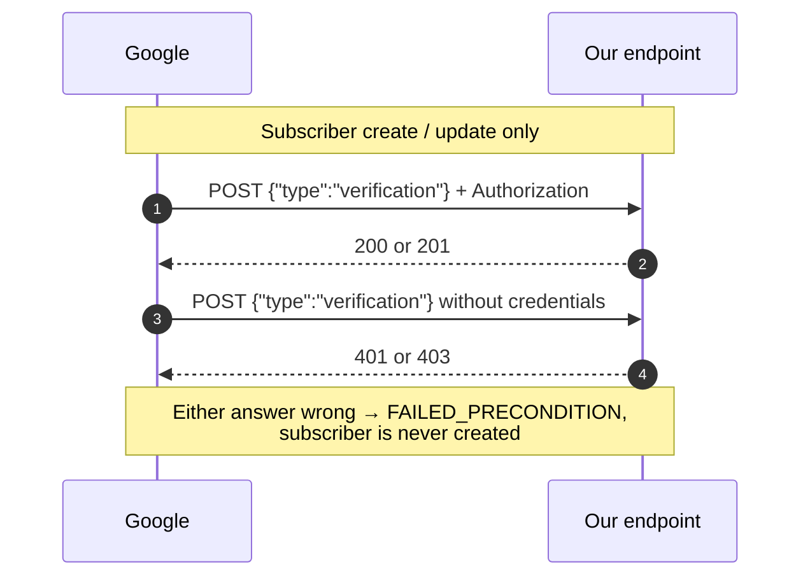

# Ingestion

Part of the [health-cloud design context](CONTEXT.md). What Google actually
sends, and what the endpoint receiving it must do. The single most expensive
mistake available in this project is misreading the payload shape, so that is
first.

## The central mechanic

**The webhook does not deliver health data.** It delivers change pointers, as
a JSON **array of envelopes**, each wrapping one pointer under `data`:

```json
[
  {
    "data": {
      "version": "1",
      "clientProvidedSubscriptionName": "auto-<project>-<subscriber>-WEBHOOK_DATA_TYPE_SLEEP",
      "healthUserId": "...",
      "operation": "UPSERT | DELETE",
      "dataType": "sleep",
      "intervals": [ { "physicalTimeInterval": {...},
                       "civilDateTimeInterval": {...},
                       "civilIso8601TimeInterval": {...} } ],
      "recordId": "..."
    }
  }
]
```

> **Verified against live traffic, 2026-09-24.** The array-of-envelopes shape is
> not what the documentation's example suggests, and getting it wrong is not
> cheap: a parser written against a bare object refused every real notification
> with `403`, and because the refusal shared an exception type with signature
> failure it looked like a crypto problem. One delivery can carry **several**
> pointers, so a parser that reads only the first silently loses data. A bare
> object is still accepted, since the docs show one.

The notification says *that* steps changed for a user over an interval, never
what the step count is. The server must then query the Health API with that
user's access token to read the values. This is the API's design, not a
configuration we can change, and it is why a fetcher worker is mandatory rather
than an architectural preference.

## Webhook endpoint requirements

- Public HTTPS, TLSv1.2+.
- **Two-step verification handshake** on subscriber create/update:
  - authorized `POST {"type":"verification"}` → must return **200 or 201**
  - *unauthorized* `POST` (same body, no credentials) → must return **401 or 403**
  - failing either → `FAILED_PRECONDITION`, with no useful detail



- **Signature:** ECDSA P-256 / SHA-256, Base64 in the `GOOGLE-HEALTH-API-SIGNATURE`
  header, verified against Tink's public keyset at
  `https://www.gstatic.com/googlehealthapi/webhooks/webhooks_public_keyset.json`
  (rotated every 30 days — fetch and cache, never pin).
- **Acknowledge with `204 No Content` immediately.** Anything else triggers
  retry with exponential backoff for up to 7 days.
- **Match the handshake body exactly**, i.e. `body == {"type": "verification"}`.
  Accepting any body that merely *contains* that key lets a caller holding the
  shared secret attach the marker to a change pointer and skip signature
  verification entirely — the secret alone must never be sufficient. Found by
  security review, 2026-09-24.
- **Keep "bad signature" and "unreadable body" as distinct failures.** Both
  answer `403`, but a body Google signed that we cannot parse means *our*
  parser is wrong, and it must say so loudly. Collapsing them into one silent
  refusal is what hid the [payload-shape bug](#the-central-mechanic) above.

## Rate limits

300 requests/minute per user; effectively ~2.5 QPS for an unverified app.
Throttling returns `429`. Backfill must be paced accordingly.

## Reading the values back

The pointer says only *that* something changed. What follows is how the values are
actually fetched, and it is almost entirely made of corrections to the reference —
every claim below was checked against the live API on **2026-09-28**, because the
reference had already been wrong once about the webhook payload shape.

`GET /v4/users/me/dataTypes/{dataType}/dataPoints`, `pageToken` for pages, `filter`
for the window.

**Data type ids are kebab-case.** `heart-rate`. Both `heart_rate` and `heartRate`
are rejected with *"Invalid data type ID"*, and the reference uses camelCase in one
place and kebab-case in another. The union field inside the payload is
camelCase (`heartRate`) even when the path segment is not, so the two are not
interchangeable.

**A real dataPoint has no identifier.** The reference describes a `name` of the form
`users/{user}/dataTypes/{type}/dataPoints/{id}`; a real point carries exactly
`{"dataSource", "steps"}`. So the record id is **derived** — a digest of the time
window and the data source, deliberately excluding the measured value so that a
correction maps to the same row instead of inserting beside it. See
[data model](data-model.md).

**`civilStartTime` is a nested object**, `{"date": {...}, "time": {...}}`, not the
ISO string the field list implies. The flat-object parser silently returned nothing
for every real payload and the local columns fell back to deriving from
`startUtcOffset` — the same answer by luck, with no error either way.

**The filter field is a property of the type, not of its shape.** Verified by trying
every candidate spelling and keeping what returned 200:

| Type | Filter field |
| --- | --- |
| `steps`, `distance`, `altitude` | `interval.start_time` |
| `sleep` | `interval.end_time` — *not* `start_time` |
| `weight` | `sample_time.physical_time` |
| everything else | **none accepted** |

A type with no known field is fetched **unfiltered and narrowed locally**. A guess
would be worse: a wrong field name is a 400, and a wrong-but-valid one silently
filters on something else.

**Results come back newest first**, which is what makes unfiltered fetching viable:
once a page falls entirely before the window, everything after it is older still and
paging stops. Date-only daily summaries use their bare civil `date` for the same
check, with a day's margin for the unknown UTC offset; otherwise they can hit the
50-page safety limit while paging through history. Without the stop, fetching one
hour of `heart-rate` walks the user's whole history.

**The real page cap is ~5000**, not the documented 10000 — asking for 5000, 10000 or
20000 all return about 4996. Session types cap at 25 and reject more rather than
clamping. This is not a micro-optimisation: `heart-rate` produces roughly 34,000
points a day, which is 7 pages at 5000 and 34 at 1000.

**Some types cannot be read with `list` at all.** The API answers *"List is not
supported for data type X, but the following actions are supported: ..."*:

- `floors`, `total-calories`, `calories-in-heart-rate-zone` → `rollUp`/`dailyRollUp`
  only. `floors` is collected as a per-civil-day `dailyRollUp` total in
  `unknown_data_points`, recomputed on UPSERT and DELETE; the other two are
  **still not collected**. Google serves only a few months of history, so those
  remain live gaps.
- `menstrual-period`, `moods`, `ovulation-test`, `symptoms` → `create`/`update`
  only. User-entered, nothing to read, nothing missing.

A notification for one of these is acknowledged with a warning rather than retried
into `max_deliver`, since no number of attempts can change the answer.

**Throttling and 5xx are retried** with a doubling delay, up to three times. The
limit is 300 requests a minute for one user, and a paginated read of a
high-frequency type reaches it on its own: `heart-rate` answered 503 partway through
pagination during exactly this work. Failing outright would discard the pages
already fetched.

**An error body is never logged or raised.** A 4xx from this endpoint can echo the
filter, and the filter says which user's data was requested over which window.
