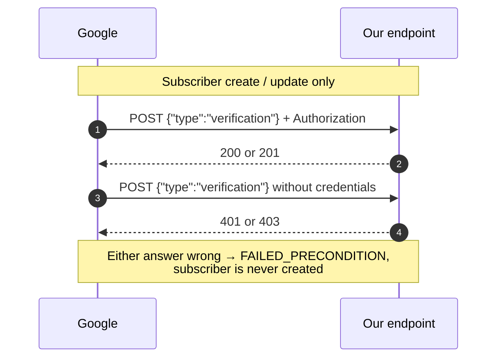

# Ingestion

Part of the [health-cloud design context](CONTEXT.md). What Google actually
sends, and what the endpoint receiving it must do. The single most expensive
mistake available in this project is misreading the payload shape, so that is
first.

## The central mechanic

**The webhook does not deliver health data.** It delivers change pointers, as
a JSON **array of envelopes**, each wrapping one pointer under `data`:

```json
[
  {
    "data": {
      "version": "1",
      "clientProvidedSubscriptionName": "auto-<project>-<subscriber>-WEBHOOK_DATA_TYPE_SLEEP",
      "healthUserId": "...",
      "operation": "UPSERT | DELETE",
      "dataType": "sleep",
      "intervals": [ { "physicalTimeInterval": {...},
                       "civilDateTimeInterval": {...},
                       "civilIso8601TimeInterval": {...} } ],
      "recordId": "..."
    }
  }
]
```

> **Verified against live traffic, 2026-09-24.** The array-of-envelopes shape is
> not what the documentation's example suggests, and getting it wrong is not
> cheap: a parser written against a bare object refused every real notification
> with `403`, and because the refusal shared an exception type with signature
> failure it looked like a crypto problem. One delivery can carry **several**
> pointers, so a parser that reads only the first silently loses data. A bare
> object is still accepted, since the docs show one.

The notification says *that* steps changed for a user over an interval, never
what the step count is. The server must then query the Health API with that
user's access token to read the values. This is the API's design, not a
configuration we can change, and it is why a fetcher worker is mandatory rather
than an architectural preference.

## Webhook endpoint requirements

- Public HTTPS, TLSv1.2+.
- **Two-step verification handshake** on subscriber create/update:
  - authorized `POST {"type":"verification"}` → must return **200 or 201**
  - *unauthorized* `POST` (same body, no credentials) → must return **401 or 403**
  - failing either → `FAILED_PRECONDITION`, with no useful detail



- **Signature:** ECDSA P-256 / SHA-256, Base64 in the `GOOGLE-HEALTH-API-SIGNATURE`
  header, verified against Tink's public keyset at
  `https://www.gstatic.com/googlehealthapi/webhooks/webhooks_public_keyset.json`
  (rotated every 30 days — fetch and cache, never pin).
- **Acknowledge with `204 No Content` immediately.** Anything else triggers
  retry with exponential backoff for up to 7 days.
- **Match the handshake body exactly**, i.e. `body == {"type": "verification"}`.
  Accepting any body that merely *contains* that key lets a caller holding the
  shared secret attach the marker to a change pointer and skip signature
  verification entirely — the secret alone must never be sufficient. Found by
  security review, 2026-09-24.
- **Keep "bad signature" and "unreadable body" as distinct failures.** Both
  answer `403`, but a body Google signed that we cannot parse means *our*
  parser is wrong, and it must say so loudly. Collapsing them into one silent
  refusal is what hid the [payload-shape bug](#the-central-mechanic) above.

## Rate limits

300 requests/minute per user; effectively ~2.5 QPS for an unverified app.
Throttling returns `429`. Backfill must be paced accordingly.
