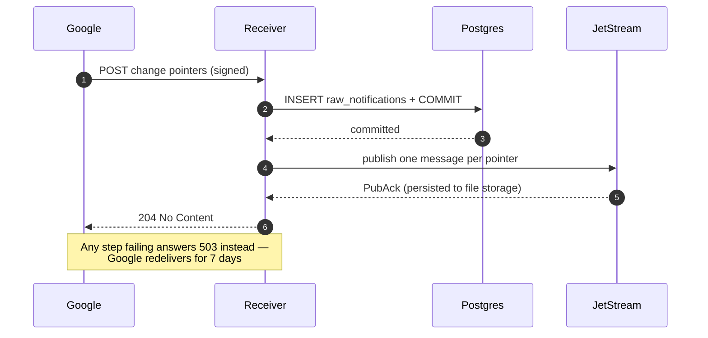

# Orchestration

Part of the [health-cloud design context](CONTEXT.md). How a notification gets
from the receiver to a row in Postgres: the broker, the flow, and why the
ordering of those steps is what makes the pipeline lossless.

Prefect 3, self-hosted. Settled 2026-09-25.

**What Prefect guarantees, and what it does not.** Prefect is *not* replay-based
durable execution. What it offers is transactions with at-most-once semantics via
a computed cache key, task result caching, and retries. Two defaults matter:
result persistence is **off** by default and lands in `~/.prefect/storage/`, and
the default cache key includes the **flow run id**, so cached results are reused
across retries of one run, not across a fresh run. Cross-run resumption needs a
deliberate `cache_key_fn` or transaction key.

That is accepted rather than worked around, because the unit of work — *fetch one
data type over one interval and upsert on the natural key* — is already
idempotent. Re-executing it costs an HTTP call, not correctness, so replay buys
little. A transaction key per `(health_user_id, data_type, interval)` makes a
rerun cheap; that is as far as it needs to go. If genuine resume-from-last-step
is ever needed, that is the point to revisit Temporal.

**The path a notification takes.** The receiver records the delivery, publishes
one message per change pointer to NATS JetStream, and only then answers 204. A
Prefect flow pulls those messages, does the work, and acknowledges each one.

The receiver half is built (step 3). The flow, and the optional trigger that
starts one promptly rather than waiting for its schedule, arrive with step 5 —
until then messages accumulate in the stream, which is exactly what a durable
work queue is for.

**NATS JetStream, not core NATS.** Core NATS is at-most-once and never replays:
a message published while no subscriber is connected is simply gone. Durability
means JetStream — a stream with **file** storage on a named volume, plus per
message acknowledgements. Memory-backed streams were rejected: a
`docker compose restart` would silently discard every un-fetched notification.
The stream sets `allow_direct` **only when `ENVIRONMENT` is `local`**: without
it a work-queue stream refuses to be paged at all, so browsing the queue while
developing needs it, but it also permits reading every queued message — each one
naming a user and what they did — so it stays off everywhere else.

**Ordering carries what atomicity cannot.** No external broker can join a
Postgres transaction, so the sequence is fixed and the ordering does the work:

1. insert the `raw_notifications` row and **commit**
2. publish one message per pointer, and **wait for the JetStream `PubAck`**
3. only then answer **204**

Any failure answers **503** instead, and Google's 7-day redelivery is the retry.
Nothing is lost. The residue of a failure is a *duplicate* audit row on
redelivery, which is harmless: the log is append-only and dedupe lives at the
data level. The audit row commits first deliberately — the reverse order could
leave work running with no record of what asked for it. Message payloads are
self-contained, so a flow never reads the audit table to do its work.

The `PubAck` matters: it is positive confirmation from the server that the
message is persisted, so the 204 is never sent on the strength of a fire and
forget publish.

**The client is asyncio-only.** `nats-py` has no synchronous client — `connect`
and `publish` are both coroutines, and nothing in the package offers a blocking
form. Since the receiver is deliberately synchronous, the connection lives on a
dedicated event-loop thread opened at startup, and the route publishes with
`asyncio.run_coroutine_threadsafe(...).result(timeout=...)`. One warm connection,
no per-request handshake, and no event loop inside a sync route.

**The flow is a pull consumer.** There is no `prefect-nats` integration; it does
not exist on PyPI. The flow fetches a batch from a durable JetStream consumer and
acknowledges each message **only after its upsert has committed**, which is what
makes at-least-once mean something. A bridge process that subscribed and called
`run_deployment` per message was rejected: it acknowledges before the work is
durable, so a failed flow loses the message, and it adds a third process with a
second state machine.

**JetStream's own deduplication is deliberately unused.** A `Nats-Msg-Id` within
the stream's duplicate window would collapse repeat deliveries, which is the same
trap as a queue-level dedupe key: a duplicate delivery and a genuine correction
to the same interval are indistinguishable. Dedupe stays at the data level — see
[Idempotency](data-model.md#idempotency).

**The stream is created by the app, not by a setup command.** Creating a
JetStream stream is an idempotent API call rather than a schema migration, so
`publisher.start()` does it on every boot and a fresh broker needs no manual
step. The NATS CLI is useful for looking at the queue but is **not** required to
run the app or the tests -- see the [README](../README.md).

**Deployment shape.** Prefect's server, its background `prefect server services`
process, its worker and its **own** Postgres container all run under
`docker-compose.yml`, deliberately separate from the app's Postgres: Prefect runs
Alembic migrations over its schema, and this project's stack table says
*Migrations: None*. Letting another tool's migrations into the app's database
would end the ability to reason about it. The FastAPI app itself is still run by
hand; containerising it belongs to step 8.

**Flow code lives in `server/flows/`.** The flows need `server.models`,
`server.db` and `server.crypto`, so they share the package. The import direction
is one-way — flows may import `server`, never the reverse. `prefect` is declared
in its own dependency group, not as an API dependency, because it pulls roughly
50 extra packages (including `alembic`, `asyncpg` and `docker`) that the web
process never imports.

**A database error's message is not safe to log.** A SQLAlchemy
`StatementError` stringifies with its statement *and bound parameters*
attached, and for the receiver those parameters are the delivery's health data.
Failure paths therefore log `type(error).__name__`, never `str(error)`. Found by
checking rather than by leaking, 2026-09-25, and covered by a test.

**Not available self-hosted:** Prefect's HTTP *webhooks*, which turn an external
request into a Prefect event, are a Cloud feature. Events and automations are in
the open-source server; the webhook receiver is not. Nothing in this design needs
it — Google talks to our own endpoint — but it is worth not rediscovering.
