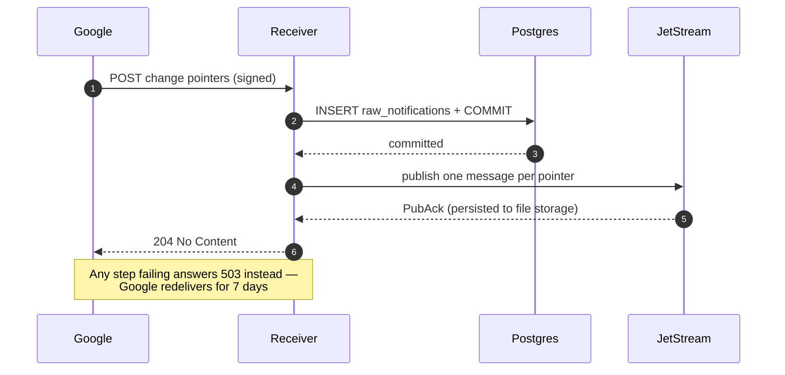

# Orchestration

Part of the [health-cloud design context](CONTEXT.md). How a notification gets
from the receiver to a row in Postgres: the broker, the flow, and why the
ordering of those steps is what makes the pipeline lossless.

Prefect 3, self-hosted. Settled 2026-09-25.

**What Prefect guarantees, and what it does not.** Prefect is *not* replay-based
durable execution. What it offers is transactions with at-most-once semantics via
a computed cache key, task result caching, and retries. Two defaults matter:
result persistence is **off** by default and lands in `~/.prefect/storage/`, and
the default cache key includes the **flow run id**, so cached results are reused
across retries of one run, not across a fresh run. Cross-run resumption needs a
deliberate `cache_key_fn` or transaction key.

That is accepted rather than worked around, because the unit of work — *fetch one
data type over one interval and upsert on the natural key* — is already
idempotent. Re-executing it costs an HTTP call, not correctness, so replay buys
little. A transaction key per `(health_user_id, data_type, interval)` makes a
rerun cheap; that is as far as it needs to go. If genuine resume-from-last-step
is ever needed, that is the point to revisit Temporal.

**The path a notification takes.** The receiver records the delivery, publishes
one message per change pointer to NATS JetStream, and only then answers 204. A
Prefect flow pulls those messages, does the work, and acknowledges each one.

Both halves are built (steps 3 and 5). Verified end to end against the live API on
2026-09-28: a run picked real notifications off the stream, refreshed the token,
fetched, upserted and acknowledged.

**The trigger is a doorbell that carries no data.** The receiver asks Prefect for a
run in a FastAPI `BackgroundTask` — *after* the 204 — and swallows any failure.
Both halves of that are deliberate:

- **After the response**, so a hung or dead Prefect structurally cannot delay
  Google's acknowledgement. By the time it runs, the message is already persisted.
- **No payload.** The flow's only input is the durable consumer. Sending the
  pointers in the trigger would mean either the stream is never drained or every
  pointer is handled twice, and it would put the work back into a fire-and-forget
  HTTP call — which is exactly why *Prefect as the queue* was rejected.

A missed trigger therefore costs latency, not data; the step 11 sweep is what makes
swallowing it honest.

**The receiver does not import `prefect`.** It calls
`POST /api/deployments/{id}/create_flow_run` with `requests`, as a ~60-line client
mirroring `SubscriberClient`. Importing `prefect` for one endpoint would put ~70
packages — `alembic`, `asyncpg`, `docker` — into the web process, none of which it
serves a request with.

**NATS JetStream, not core NATS.** Core NATS is at-most-once and never replays:
a message published while no subscriber is connected is simply gone. Durability
means JetStream — a stream with **file** storage on a named volume, plus per
message acknowledgements. Memory-backed streams were rejected: a
`docker compose restart` would silently discard every un-fetched notification.
The stream sets `allow_direct` **only when `ENVIRONMENT` is `local`**: without
it a work-queue stream refuses to be paged at all, so browsing the queue while
developing needs it, but it also permits reading every queued message — each one
naming a user and what they did — so it stays off everywhere else.

**Ordering carries what atomicity cannot.** No external broker can join a
Postgres transaction, so the sequence is fixed and the ordering does the work:

1. insert the `raw_notifications` row and **commit**
2. publish one message per pointer, and **wait for the JetStream `PubAck`**
3. only then answer **204**

Any failure answers **503** instead, and Google's 7-day redelivery is the retry.
Nothing is lost. The residue of a failure is a *duplicate* audit row on
redelivery, which is harmless: the log is append-only and dedupe lives at the
data level. The audit row commits first deliberately — the reverse order could
leave work running with no record of what asked for it. Message payloads are
self-contained, so a flow never reads the audit table to do its work.

The `PubAck` matters: it is positive confirmation from the server that the
message is persisted, so the 204 is never sent on the strength of a fire and
forget publish.

**The client is asyncio-only.** `nats-py` has no synchronous client — `connect`
and `publish` are both coroutines, and nothing in the package offers a blocking
form. So the route and the flow are both `async`, using the loop the framework
already runs rather than opening one, and the blocking half — SQLModel and
`requests` — goes to a worker thread as a single unit per pointer.

**The consumer closes; it does not drain.** The publisher drains because it may
have publishes in flight. A pull consumer has none: it asked for each batch
explicitly and awaited every ack. Draining it is worse than pointless — `drain()`
waits for the pull subscription to finish, a pull subscription never finishes on
its own, so it blocks until the drain timeout and then raises `DrainTimeoutError`.
Found by running it, 2026-09-28.

**Retries live in the broker, not in Prefect.** The task has no Prefect-level
retries. JetStream's redelivery already is the retry and it is the better one: it
survives the process dying. A second in-process layer was written and removed —
excluding an expired token from it needs `retry_condition_fn`, and that hands the
state's result back as a coroutine, so the check silently never ran and the one
error that must not be retried was being retried on every failure.

**An expired token stops the whole run.** On `TokenExpiredError` the handler raises
`DrainAborted`: the drain returns immediately with everything still queued. The
alternative is destructive rather than merely wasteful — every remaining message
would fail for the same reason, each failure spends one of its five `max_deliver`
attempts, and a queue of a hundred notifications would be burned through in minutes
and then dropped for good. Stopping costs one attempt on one message.

**The flow is a pull consumer.** There is no `prefect-nats` integration; it does
not exist on PyPI. The flow drains a durable JetStream consumer — batches of 50
until the stream is empty, `ack_wait` 60s, `max_deliver` 5 — and acknowledges each
message **only after its upsert has committed**, which is what makes at-least-once
mean something. A bridge process that subscribed and called `run_deployment` per
message was rejected: it acknowledges before the work is durable, so a failed flow
loses the message, and it adds a third process with a second state machine.

Draining rather than handling one batch is what lets a single run catch up after an
outage instead of needing one trigger per stranded message. Overlapping runs are
safe: a work-queue stream hands each message to exactly one consumer.

**Prefect run logs show fetch progress.** Each task logs its data type,
UPSERT/DELETE operation, number of intervals and hashed user handle when it
starts, then the fetched point/segment counts when it finishes. Failures log
only the error class, never an exception message that may contain bound health
data. The flow logs the drain totals and warns when any message failed or the
drain stopped early. No pointer body, measurement, access token, or raw user id
goes into these progress lines.

An unreadable message is **terminated**, not retried — redelivery cannot make
malformed JSON parse, and five attempts at nonsense only delay what is behind it.

**JetStream's own deduplication is deliberately unused.** A `Nats-Msg-Id` within
the stream's duplicate window would collapse repeat deliveries, which is the same
trap as a queue-level dedupe key: a duplicate delivery and a genuine correction
to the same interval are indistinguishable. Dedupe stays at the data level — see
[Idempotency](data-model.md#idempotency).

**The stream is created by the app, not by a setup command.** Creating a
JetStream stream is an idempotent API call rather than a schema migration, so
`publisher.start()` does it on every boot and a fresh broker needs no manual
step. The NATS CLI is useful for looking at the queue but is **not** required to
run the app or the tests -- see the [README](../README.md).

**Deployment shape.** Prefect's server, its background `prefect server services`
process and its **own** Postgres container run under `docker-compose.yml`,
deliberately separate from the app's Postgres: Prefect runs Alembic migrations
over its schema, and this project's stack table says *Migrations: None*. Letting
another tool's migrations into the app's database would end the ability to
reason about it. The Prefect images are pinned to the version `uv.lock` gives
the worker, so a pull never runs Prefect's migrations unattended. The fetcher
and rollup deployments are served by the `worker` container, running
`python -m server.flows.fetch deploy` from its own image, the only one with
`prefect` installed. See [Operations](operations.md#containers).

**Deployments are found by name, never by id.** The receiver's doorbell looks
up `fetch-notifications/fetcher` on its first ring and keeps the id, looking it
up again if Prefect answers 404; the backfill finds `rollup-heart-rate/rollup`
the same way. A fresh Prefect gets new ids when the worker first registers the
deployments, so an id in `.env` would need copying across by hand after every
first start.

**Flow code lives in `server/flows/`.** The flows need `server.models`,
`server.db` and `server.crypto`, so they share the package. The import direction
is one-way — flows may import `server`, never the reverse. `prefect` is declared
in its own dependency group, not as an API dependency, because it pulls roughly
50 extra packages (including `alembic`, `asyncpg` and `docker`) that the web
process never imports.

**A database error's message is not safe to log.** A SQLAlchemy
`StatementError` stringifies with its statement *and bound parameters*
attached, and for the receiver those parameters are the delivery's health data.
Failure paths therefore log `type(error).__name__`, never `str(error)`. Found by
checking rather than by leaking, 2026-09-25, and covered by a test.

### The rollup flow

`rollup-heart-rate` rebuilds the [stored hourly heart-rate
summaries](data-model.md#stored-summaries) for one user over a span of local
hours, from the samples already in Postgres. It takes the user and the span as
parameters, commits a day of hours at a time, and is served from the same
process as the fetcher by `python -m server.flows.fetch deploy`, under the
deployment `rollup-heart-rate/rollup`.

**A heart-rate message is acked only once its rollup run exists.** When a
`heart-rate` or `time-in-heart-rate-zone` message has been fetched and
committed, the fetch task creates a rollup run for the local hours it wrote,
with `run_deployment(timeout=0)`, and only then returns, which earns the ack.
It waits for the run to be **created**, not to finish. If Prefect cannot be
reached, the task raises, the message stays unacknowledged, and the redelivery
repeats the upsert as a no-op and asks again. That is what makes the rollup
durable without a table of pending hours.

**The idempotency key** is the notification id, data type and span. A redelivered
message gets back the run it already created; a later notification about the same
hours has a new id, so its correction gets its own run.

**Retried by Prefect, unlike the fetch.** Nothing redelivers a rollup run, so the
flow has `retries=3`, a minute apart. A retry repeats a rebuild, which is
harmless. A run Prefect marks *Crashed* is not retried; its hours stay stale until
the step 11 rebuild or `rollup rebuild` (see
[Decisions](decisions.md#deferred)).

**The backfill starts one run when it finishes**, over every local hour its UTC
window can touch (widened by 14 hours each way), through Prefect's REST API: the
CLI, like the receiver, does not import `prefect`, and finds the deployment by
name rather than by a setting. If the run cannot be created, the backfill exits
with an error naming the `rollup rebuild` command that does the same work in
process.

**Not available self-hosted:** Prefect's HTTP *webhooks*, which turn an external
request into a Prefect event, are a Cloud feature. Events and automations are in
the open-source server; the webhook receiver is not. Nothing in this design needs
it — Google talks to our own endpoint — but it is worth not rediscovering.

### The scheduled backfill

`backfill-recent` fetches the last 24 hours of every type for every consented
user, **every hour**. It is a Prefect deployment, `backfill-recent/recent`,
served by the worker beside the fetcher and the rollup, with a Prefect schedule
of `0 * * * *`; Prefect's scheduler service (`prefect-services`) creates the
runs, so nothing on the host needs a timer.

**Why it exists.** Webhooks are the fast path, and they miss things. Google
lists an `exercise` session only once it is finished and sends no notification
for the finished session, so a workout is never stored by a notification-driven
fetch. Notifications sent to an endpoint that is down are lost once Google stops
retrying, and a new subscriber is never told about data that synced before it
existed. See [Ingestion](ingestion.md).

**Why a day, run every hour.** A phone can upload hours after the activity, and a
finished workout was seen listed nearly two hours after it ended. With a
24-hour window run hourly, anything Google lists within a day is fetched by
about 23 runs. A session crossing the window's edge is kept, because the fetcher
keeps a session that *overlaps* the window. Data that reaches Google more than a
day late is left to the daily 7-day `:reconcile`.

**Types run one after another, never in parallel**, because of Google's rate
limit of 300 requests a minute per user. A run makes roughly 30 to 60 requests,
and heart-rate alone pages through about 40,000 points. The deployment's
`concurrency_limit=1` keeps a slow run from overlapping the next hour's for the
same reason. A full run measured 2 min 20 s on 2026-11-25.

**One task per type**, using the same strategy as `backfill run`
(`server/health/backfill.py`): a day at a time for a type Google filters, one
backward pass for one it does not. The Prefect UI shows each type's task, so a
failure names its type. **A failed type does not stop the others**; the run is
marked *Failed* at the end with the failed types in its message. **An expired
token stops the run at once**, since every type would fail the same way. Tasks
are not retried: the next run, an hour later, covers the same window.

**Heart-rate hours are rebuilt** by one `rollup-heart-rate` run per user over the
hours the backfill wrote, created the same way the fetcher creates one.

**A manual run** can reach further back with the `window_hours` parameter, from
the Prefect UI or `prefect deployment run backfill-recent/recent -p
window_hours=72`.
